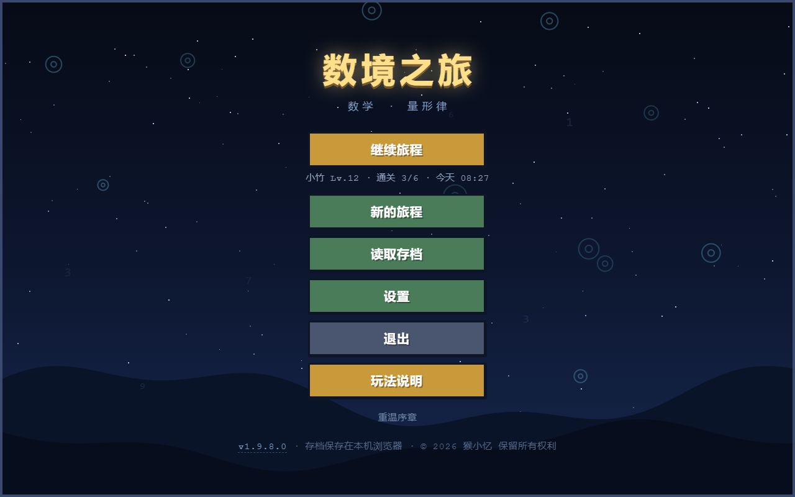
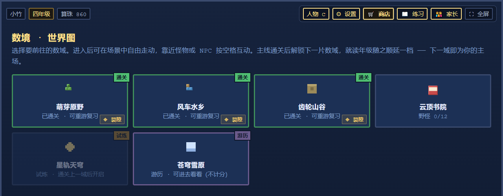
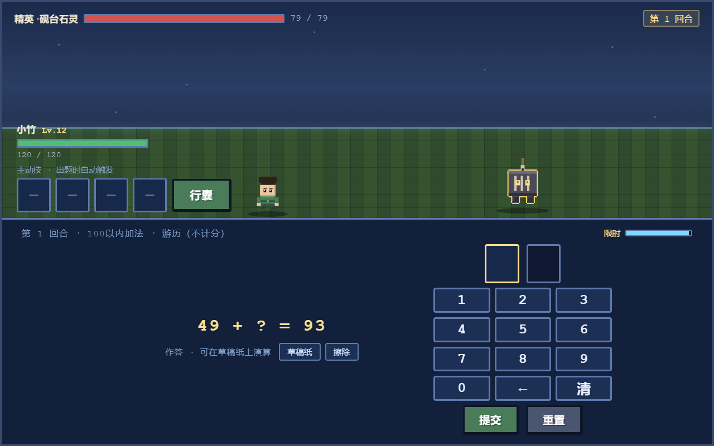
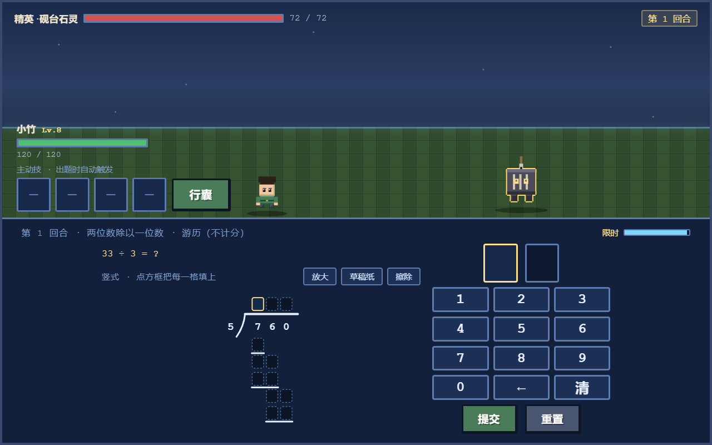
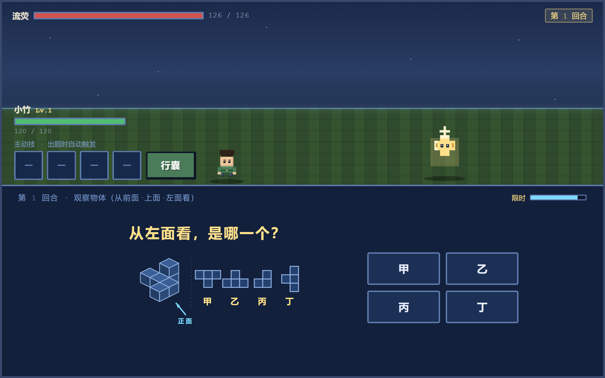

<div align="center">

# 数境之旅

**把小学数学题变成打怪冒险 —— 让孩子自己愿意坐下来刷题。**

[🎮 在线试玩](https://shujing-zhilv.app.workbuddy.host/?sharecode=SGOF6OSZSN) · [📖 B 站详细介绍](https://www.bilibili.com/opus/1263335042153709573) · [玩法](#玩法) · [截图](#截图) · [更新日志](docs/02-更新公告/更新公告-完整版.md)



</div>

---

## 这是什么

一个跑在浏览器里的**单机**数学闯关游戏。六个数域分别对应小学一至六年级，孩子扮演书院弟子「小竹」，靠答对数学题来打退怪物、修复破碎的「数律」。

面向小学 1~6 年级，题库覆盖**人教 / 北师大 / 苏教 / 冀教**四个教材版本。

它想解决的问题很具体：**练题本身不有趣，催着练更不有趣。** 所以把「答对」变成「打出伤害」，让进度成为动力，而不是家长的压力。

## 玩法

- **答对才打得动**——每道题是一次攻击，答错怪物反而回血。
- **六个数域 = 六个年级**：萌芽原野（一）→ 风车水乡（二）→ 齿轮山谷（三）→ 云顶书院（四）→ 星轨天穹（五）→ 苍穹雪原（六）。打通一域解锁下一片，就读年级也随之顺延。
- **80 个知识点 / 460 道变式**，按年级与教材版本自动出题，从「20 以内加法」一直到「扇形统计图」。
- **不是只有选择题**：竖式演算（点方框逐格填）、点格子画对称轴、三视图、统计图表、分数通分排版。
- **家长看得见**：家长页有每个数域的正确率、薄弱知识点、每周报告，还有需要家长口令才能进的心愿卡。
- **有结尾**：六域全通后是一卷谢幕卷，逐域点名 + 真实数据 + 称号，不是打完就没了。

## 给家长

如果你是在给孩子找练习，这几件可能是你想先知道的：

- **它会主动把孩子叫回来吗？** 不会。没有推送、没有签到奖励、没有「再不玩就亏了」。它是单机游戏，关掉就是关掉了。
- **能看出孩子哪里薄弱吗？** 能。地图上的「👪 家长」按知识点列出练习情况，需要多练的排在最前面；还有错题分布、每道题的作答用时，以及一份可以复制或导出成图片的周报。
- **会不会让孩子花钱？** 不会。没有内购、没有广告、没有任何第三方请求，一分钱都花不出去。
- **数据会上传吗？** 不会。存档只在这台设备的浏览器里，不上传、不同步。想换设备的话，存档页有「导出存档」，在新设备上导入就能接着玩。
- **题目能改吗？** 能。附带的题库编辑器可以改内置题、导入自己的题、切换教材版本，改动只影响本机。
- **「心愿卡」是什么？** 是家长自己写的现实奖励清单（比如「周末去公园」），要家长口令才能设置。它不花一分钱，也不改任何游戏数值 —— 孩子靠真突破挣卡来兑换。

## 截图

<table width="100%">
<tr>
<td width="50%" valign="top"><br><sub><b>世界图 · 六个数域各有状态</b></sub></td>
<td width="50%" valign="top"><br><sub><b>答题战斗 · 答对就是一次攻击</b></sub></td>
</tr>
<tr>
<td width="50%" valign="top"><br><sub><b>竖式演算 · 点方框填每一格</b></sub></td>
<td width="50%" valign="top"><br><sub><b>图形题 · 程序化绘制的三视图</b></sub></td>
</tr>
</table>

## 技术

- **单个 HTML 文件**：`game/index.html`（约 1.6 MB），双击就能玩，不需要装任何东西。
- **零外部依赖**：
  - 没有 CDN、没有第三方库、没有图片和音频文件。
  - 美术全部由 Canvas **程序化绘制**；音效全部由 Web Audio **实时合成**。
  - 游戏运行期间 `fetch(` 命中 **0 次** —— 断网也能完整通关。
- **存档在本机**：走 `localStorage`，不上传、不同步、不联网。想换设备就在存档页「导出存档」，到新设备「导入存档」读回。
- **自带题库编辑器**：`game/题库编辑器.html`。家长和老师可以改内置题、导入自己的题、切换教材版本，改动只影响本机。
- **102 套自动化测试**：覆盖出题正确性、判分、存档往返、小屏布局、剧情一致性等。测试脚手架在开发环境里跑，**未随仓库发布**（这个仓库只放游戏本体）。

## 目录

```
game/                  游戏本体（index.html 单文件 + 题库编辑器）
screenshots/           README 用的截图
docs/02-更新公告/       更新公告（短版 + 完整版）
```

> 这个仓库**只放游戏本体和更新公告**。设计文档、题库源、测试与发布脚本都在开发环境里，不随仓库发布。

## 更新日志

按版本倒序排列，越靠上越新：[更新公告（完整版）](docs/02-更新公告/更新公告-完整版.md)

游戏内也能看：标题屏右下角的版本号点一下，就是这一版改了什么。

## 创作与版权声明

- 游戏玩法、关卡设计、数值体系与 UI 方案由**本人构思设计**；程序代码由 AI 辅助生成，本人负责审查、修复缺陷与迭代优化。
- 本项目**游戏本体不使用任何外部素材**：美术由代码程序化绘制，音效由 Web Audio 实时合成，无第三方图片 / 音频 / 字体依赖。
- 本项目**不包含任何 GPL / AGPL 等传染型开源代码片段**。
- 本项目采用**保留所有权利（All Rights Reserved）**，详见 [LICENSE](LICENSE)。**仅供学习参考，请勿商用或二次分发。**
- 商标与美术资产的著作权归作者所有。

---

<div align="center">
<sub>© 2026 猴小忆 · 保留所有权利</sub>
</div>
